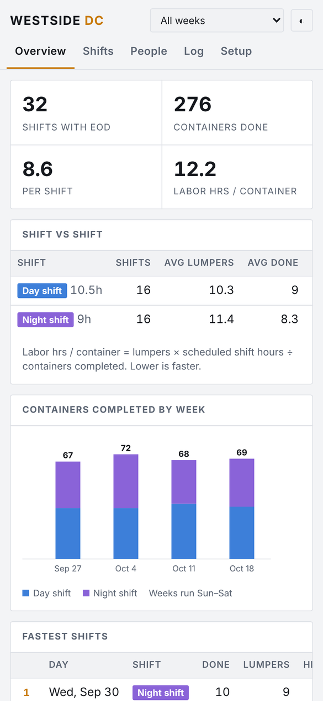
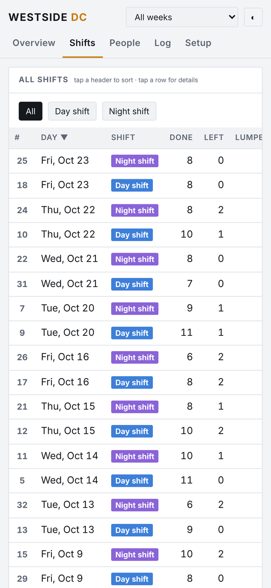
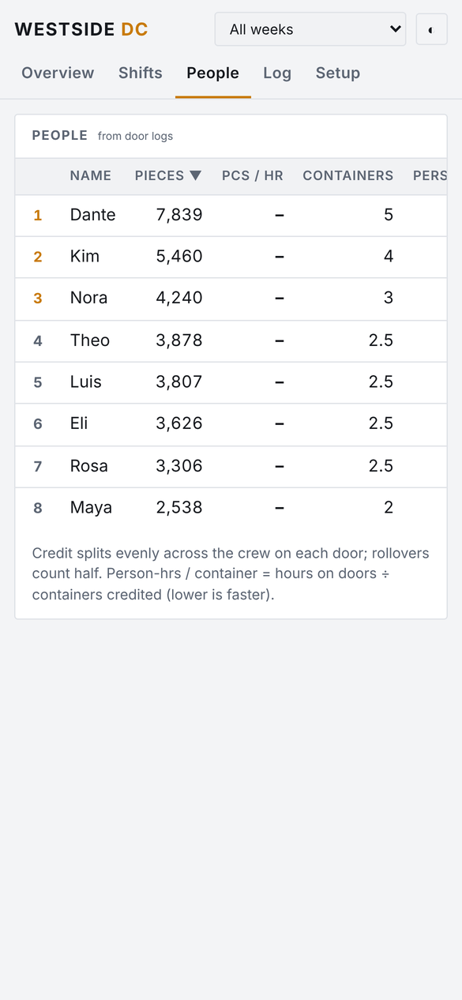

# Shift Board

**Try it:** https://bjessief-apps.github.io/Shift-Board/ (works best on a phone)

Every shift at a warehouse posts its numbers at the end of the day, and then they just get buried in a group chat. I wanted to see how shifts actually stack up over weeks, who's fastest, where the labor is going, without scrolling back through screenshots. You paste in the report and Shift Board does the math.

<table>
  <tr>
    <td align="center"> Overview</td>
    <td align="center"> Every shift, ranked</td>
    <td align="center"> People</td>
  </tr>
</table>

Screenshots use a made-up warehouse with sample names and numbers. Real data never leaves your phone.

A simple, private shift logger for warehouse crews. Log each shift's start and end-of-day numbers and door-by-door work, and the board ranks shifts and people for you.

## What it does

- **Overview:** containers completed, labor hours per container, shift vs shift comparison, weekly chart, fastest and slowest shifts.
- **Walk:** follow a shift live. Swipe through the doors to log each container, put your crew on doors from a live board with door timers, then save the end-of-day numbers. Finished doors save to the same door logs as the Log page (rollovers save just the part unloaded), and every logged door's times can be edited afterward.
- **Shifts:** every logged shift, sortable and ranked. Tap a shift to see its reports and edit numbers.
- **People:** rankings built from door logs: pieces credited, pieces per hour, containers credited, person-hours per container.
- **Log:** paste a start or end-of-day report and the numbers are read for you, or log a single door (door, piece count, crew, start and end time).
- **Setup:** opens first on a new device. Your warehouse or agency name, worker title, your own shift schedules (name, days, start and end times), and your crew, plus backup and restore.

## Privacy

There is no backend and no account. Everything is saved only in the browser on your device. Nothing you enter is uploaded or included in this repository. Use **Setup → Save backup** to keep a copy or to move your data to another device.

## How credit is split

- Each door's credit is split evenly across the crew on it. A rolled-over door counts as half.
- Labor hours per container = workers × scheduled shift hours ÷ containers completed. Shift hours come from each shift's start and end times in Setup.
